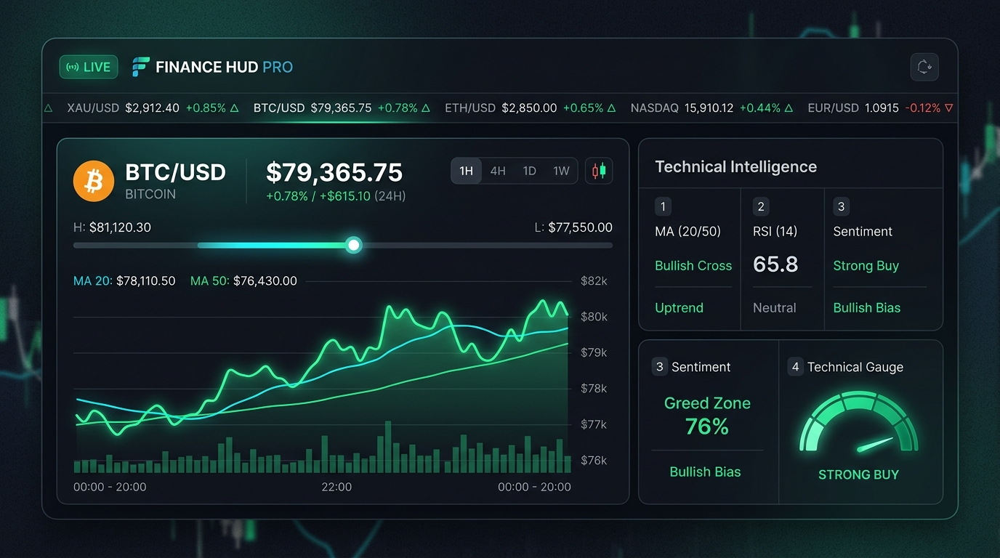

# 📈 Finance Terminal & Ticker HUD Pro

[](https://developer.chrome.com/docs/extensions/mv3/)
[](https://github.com)
[](https://github.com)
[](https://github.com)
[](https://github.com)

<p align="center">
  
</p>

A professional-grade, Bloomberg and TradingView-inspired financial terminal and live HUD built as a modern Chrome extension (Manifest V3) and standalone desktop workstation.

Track **Cryptocurrencies** (BTC, ETH, SOL), **Commodities & Precious Metals** (Gold Spot XAU/USD, Crude Oil), **Forex Pairs** (EUR/USD, USD/JPY, DXY), and **Major Indices** (S&P 500, Nasdaq QQQ) with live candlestick charting, technical indicator intelligence, continuous rolling ticker tape, smart browser toolbar badge, and an intuitive USD-first portfolio tracker.

---

## ✨ Key Features

### 1. ⚡ Live Sub-Second WebSockets Streaming & Live Beacon
- **Direct Binance WebSocket Integration**: Subscribes directly to `wss://stream.binance.com:9443/ws/!miniTicker@arr` for sub-second, real-time tick-by-tick market data across crypto and metals.
- **Pulsating Live Beacon**: Header beacon badge dynamically displays `WS LIVE` with a pulsing emerald radar dot when streaming, automatically falling back to polling if offline.
- **Tick-by-Tick Animations**: Live price updates flash instantly (emerald green for upticks, rose red for downticks) on the hero card and watchlist rows. Active chart candles evolve in real-time as ticks arrive.

### 2. 📊 Professional Canvas Chart Engine with MA Overlays & Crosshairs
- **Dual Visualizations**: Switch seamlessly between smooth **Area Spline** with gradient fills and crisp **OHLC Candlesticks**.
- **Moving Average Overlays (MA 20 / MA 50)**: Interactive toggle button (`MA`) renders cyanide (MA20) and amber (MA50) moving average curves directly onto the canvas with pill indicators.
- **Interactive Precision Crosshairs**: Hovering over the chart displays high-contrast dashed crosshair lines, a right-axis price badge, and a top-bar **OHLCV Live Readout** (`O:`, `H:`, `L:`, `C:`, `V:`).
- **Multi-Timeframe Analysis**: Explore data across **1H, 24H, 7D, 1M, and 1Y** intervals.

### 3. 📰 Live Financial News Marquee & Rolling Ticker Tape
- **Dual-Mode Marquee**: Interactive toggle switches between **[Prices]** and **[News 📰]** in the top scrolling marquee.
- **Breaking News Feed**: Pulls real-time financial, macroeconomic, and crypto headlines with **BREAKING** badges and relative timestamps ("12m ago", "1h ago").
- **Interactive Controls**: Hover to pause the scrolling marquee; click any headline to open the full story in a new tab.

### 4. 🧠 Real Market Sentiment & Technical Gauge Suite
- **Real Fear & Greed Index**: Direct integration with the Alternative.me API with live caching, showing exact scores (0–100) and sentiment classifications (`Extreme Fear`, `Fear`, `Neutral`, `Greed`, `Extreme Greed`).
- **Technical Indicator Engine**: Real-time Relative Strength Index (RSI 14), MA crossovers, and a 5-segment telemetry gauge (`STRONG BUY`, `BUY`, `NEUTRAL`, `SELL`, `STRONG SELL`).

### 5. 💼 Intuitive USD-First Portfolio Tracker
- **No Complex Math**: Simply enter how much you hold in USD right now (e.g., "$500 in Bitcoin" or "$2,500 in Gold").
- **Automatic Price Locking**: Locks current market entry prices and computes exact coin/unit allocations.
- **Real-Time P&L & Donut Allocation**: Visual SVG donut chart showing asset distribution alongside live dollar and percentage return tracking over time.
- **Asset Management**: Edit holding amounts with ✏️ or delete tracked positions with 🗑️ at any time.

### 6. 📋 Robust Watchlist & Drag-and-Drop Screener
- **Zero "Resurrection" Bug**: Deleted assets stay deleted permanently—no default asset resurrection upon reload or background refresh.
- **ID-Based Drag & Drop**: Seamlessly reorder assets even while filtering or searching by symbol/name.
- **Real Sparklines**: Watchlist rows render genuine 24h price trajectories rather than randomized curves.

### 7. 🎯 Smart Browser Toolbar Badge & Audio Alerts
- **High-Precision Badge**: Displays readable price metrics on the extension icon (`79.1k`, `2.9k`, `104`).
- **Web Audio Chimes**: Synthesizes pleasant musical audio chimes on price alerts and status changes.
- **Background Sync**: Updates prices and evaluates alerts in the background service worker.

### 8. 💻 Full-Screen Workstation Mode & 4 FinTech Themes
- **Dedicated Workstation (`dashboard.html`)**: Launch via popout (⛶) for full-screen multi-monitor setups with order depth simulation.
- **Curated Themes**: Choose between **Obsidian**, **Cyberpunk**, **Midnight**, and **Crisp Light**.


---

## 🚀 Installation Guide

### Install in Google Chrome / Brave / Microsoft Edge / Opera

1. **Clone or Download** this repository to your local machine:
   ```bash
   git clone https://github.com/jrcramos/finance_tracker.git
   ```
2. Open your browser and navigate to the Extensions management page:
   - **Google Chrome / Brave**: `chrome://extensions`
   - **Microsoft Edge**: `edge://extensions`
3. Enable **Developer mode** (toggle switch in the top-right corner).
4. Click the **"Load unpacked"** button in the top-left corner.
5. Select the `finance_tracker` directory.
6. Pin **Finance Terminal & Ticker HUD Pro** to your browser toolbar for quick access!

---

## 📂 Project Architecture

```
finance_tracker/
├── manifest.json       # Chrome Extension Manifest V3 configuration
├── background.js       # Background service worker (badge sync, alarms, notifications)
├── config.js           # Universal asset catalog, storage adapters, and API endpoints
├── popup.html          # Main 580px extension popup application
├── popup.js            # Reactive terminal controller, chart engine, audio synth, and state
├── terminal.css        # FinTech design system, themes, and zero-scroll layout
├── dashboard.html      # Full-screen multi-monitor workstation mode
├── icons/              # SVG and high-resolution extension icons
└── README.md           # Project documentation and guide
```

---

## 🌐 Supported Market Feeds

| Symbol | Asset Name | Market Type | Feed Provider |
|---|---|---|---|
| `BTC/USD` | Bitcoin | Cryptocurrency | Binance / CoinGecko |
| `ETH/USD` | Ethereum | Cryptocurrency | Binance / CoinGecko |
| `SOL/USD` | Solana | Cryptocurrency | Binance / CoinGecko |
| `XAU/USD` | Gold Spot | Precious Metal | Binance Pax Gold / Market Index |
| `WTI_OIL` | Crude Oil | Commodity | Yahoo Finance |
| `S&P 500` | S&P 500 Index | Equity Index | Yahoo Finance (`^GSPC`) |
| `Nasdaq` | Invesco QQQ | Tech Index | Yahoo Finance (`QQQ`) |
| `EUR/USD` | Euro Spot | Forex Currency | Binance / Market Index |
| `USD/JPY` | Japanese Yen | Forex Currency | Yahoo Finance (`JPY=X`) |
| `DXY` | US Dollar Index | Currency Index | Yahoo Finance (`DX-Y.NYB`) |
| *Custom* | User-defined | Any | Add custom symbols dynamically |

---

## 🔒 Privacy & Security

- **100% Client-Side**: No user data, holding amounts, or portfolio balances are sent to external analytics servers.
- **Direct Public API Calls**: Requests are made directly from your browser to public market endpoints (Binance, Yahoo Finance, Alternative.me).
- **Universal Local Storage**: Settings and portfolios are stored securely in Chrome local extension storage (`chrome.storage.local`) with complete JSON export/import backup capabilities.

---

## 📄 License

MIT License. Open source and free to customize for personal or commercial use.
